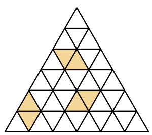

(a) The sides of an equilateral triangle with sides of length $n$ have been divided into equal parts, each of length $1$, and lines have been drawn through the points of division parallel to the sides of the triangle, thus dividing the large triangle into many small triangles. Nils has a pile of rhombic tiles, each of side $1$ and angles $60^\circ$ and $120^\circ$, and wants to tile most of the triangle using these, so that each tile covers two small triangles with no overlap. In the picture, three tiles are placed somewhat arbitrarily as an illustration. How many tiles can Nils fit inside the triangle?

(b) Arne and Berit are playing a game. They have chosen positive integers $m$ and $n$ with $n \ge 4$ and $m \le 2n + 1$. Arne begins by choosing a number from the set $\{1, 2, \ldots, n\}$, and writes it on a blackboard. Then Berit picks another number from the same set, and writes it on the board. They continue alternating turns, always choosing numbers that are not already on the blackboard. When the sum of all the numbers on the board exceeds or equals $m$, the game is over, and whoever wrote the last number has won. For which combinations of $m$ and $n$ does Arne have a winning strategy?
