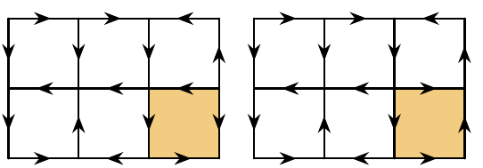

(a) Harald has a stack of $n$ cards, marked with the numbers $1, 2, \ldots, n$ in order from top to bottom. Then he reduces the stack repeatedly: Each reduction consists of removing two adjacent cards from the stack, subtracting the number $a$ on the lower card from the number $b$ on the one above, writing the difference, $b - a$, on a blank card, and inserting the new card at a freely chosen location in the stack. After $n - 1$ such reductions, he is left with just one card. For which positive integers $n$ can the number on this card be zero?

(b) Let $m$ and $n$ be positive integers. An $m \times n$ grid is called oriented if every unit edge has an arrow pointing on one of the two directions along the edge. A move consists of rotating a grid cell, along with the direction of each of the cell's four edges, by $90^\circ$. Two oriented grids are called friends if some sequence of moves will turn the first grid into the second one. Determine the largest possible size of a collection of oriented $m \times n$ grids so that no two of them are friends.

Example: The oriented $3 \times 2$ grid on the right is the result of rotating the shaded grid cell of the left grid $90^\circ$ counterclockwise.

