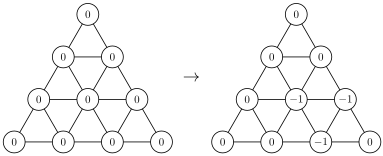

Um triângulo está dividido em nove triângulos menores, onde estão colocados contadores com o número zero em cada um dos dez vértices. Um movimento consiste em escolher um dos nove triângulos e aplicar aos três contadores desse triângulo a mesma operação: adicionar uma unidade ou subtrair uma unidade. Na figura está ilustrado um possível movimento.

Diz-se que o número inteiro $n$ é *dominante* se for possível, ao fim de alguns movimentos, obter uma configuração em que os números dos contadores são todos consecutivos e o maior desses números é $n$.

Determina todos os números dominantes.

