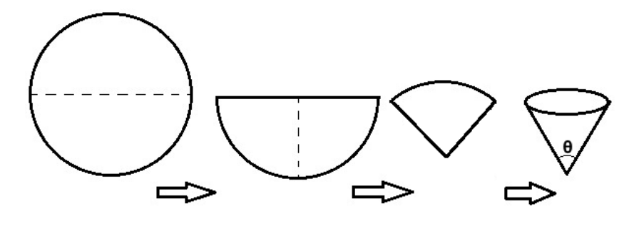

During chemistry labs, we oftentimes fold a disk-shaped filter paper twice, and then open up a flap of the quartercircle to form a cone shape, as in the diagram. What is the angle $\theta$, in degrees, of the bottom of the cone when we look at it from the side?

