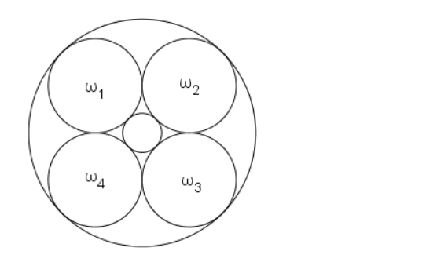

A circle of radius $1$ has four circles $\omega_1$, $\omega_2$, $\omega_3$, and $\omega_4$ of equal radius internally tangent to it, so that $\omega_1$ is tangent to $\omega_2$, which is tangent to $\omega_3$, which is tangent to $\omega_4$, which is tangent to $\omega_1$, as shown. The radius of the circle externally tangent to $\omega_1$, $\omega_2$, $\omega_3$, and $\omega_4$ has radius $r$. If $r=a-\sqrt{b}$ for positive integers $a$ and $b$, compute $a+b$.

