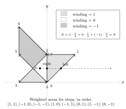

Trevor the traveller starts at the origin of $\mathbb{R}^2$. He then takes a series of $8$ steps that change his position by a vector in the set $\{(a,b)\in\mathbb{Z}^2 : |a|,|b|\le 1\text{ and }(a,b)\ne(0,0)\}$. He takes each of the $8$ possible steps exactly once, and takes the steps in uniformly random order, so that he returns to the origin. The *winding number* of each point $P$ in $\mathbb{R}^2$, except those exactly on the path, is defined as the number of times any ray starting at $P$ going out to infinity crosses a left-pointing portion of Trevor's path minus the number of times the ray crosses a right-pointing portion of the path, where left and right are defined relative to the ray. Let $A$ be the area in $\mathbb{R}^2$ weighted by winding number. An example is shown below. Find the expected value of $A^2$.

