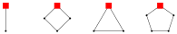

There is an alphabet consisting of four shapes; a Segment, a Diamond, a Triangle, and a Pentagon. All of these shapes are regular. Each shape has a marked vertex that indicates its current orientation (as shown below).

Richard creates a password of length $6$ from this four-shape alphabet. Then, every second, Richard rotates each Segment by $180^\circ$, each Diamond by $90^\circ$ clockwise, each Triangle by $120^\circ$ clockwise, and each Pentagon by $72^\circ$ clockwise. It turns out that the shapes are first all oriented the same as in his original password after $20$ seconds. How many distinct passwords could Richard have chosen?

