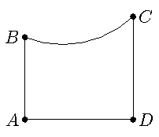

На рисунке изображена фигура $ABCD$. Стороны $AB$, $CD$ и $AD$ этой фигуры - отрезки (причём $AB \parallel CD$ и $AD \perp CD$); $BC$ - дуга окружности, причём любая касательная к этой дуге отсекает от фигуры трапецию или прямоугольник. Объясните, как провести касательную к дуге $BC$, чтобы отсекаемая фигура имела наибольшую площадь.

