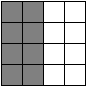

В квадрате $4 \times 4$ клетки левой половины покрашены в чёрный цвет, а остальные — в белый. За одну операцию разрешается перекрасить в противоположный цвет все клетки внутри любого прямоугольника. Как за три операции из первоначальной раскраски получить шахматную?

