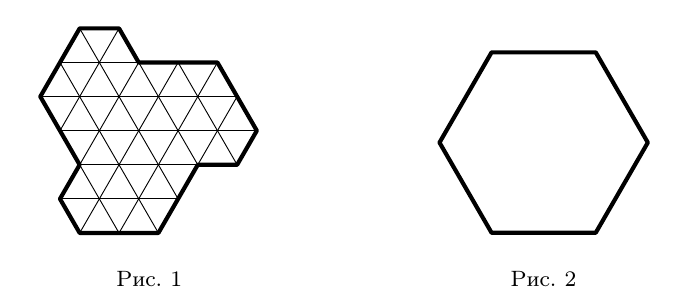

Покажите, как разрезать (не обязательно по линиям сетки) фигуру на рис. 1 на три равные части и сложить из этих частей правильный шестиугольник, изображённый на рис. 2. Оставлять дырки и накладывать части друг на друга нельзя.

