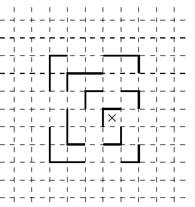

Внутри забора, представляющего собой замкнутую несамопересекающуюся ломаную, заперт тигр. На рисунке видна только часть забора (положение тигра показано крестиком). Нарисуйте, как мог бы выглядеть весь забор (забор может идти только по линиям сетки).

