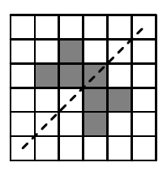

На клетчатом листе бумаги было закрашено несколько клеток так, что получившаяся фигура не имела осей симметрии. Ваня закрасил ещё одну клетку. Могло ли у получившейся фигуры оказаться 4 оси симметрии? (Пример фигуры с одной осью симметрии приведён на рисунке, ось симметрии показана пунктиром.)

