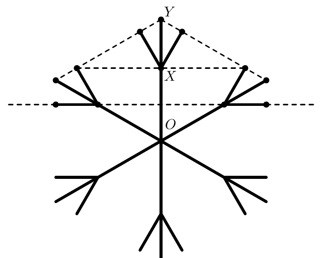

На рисунке изображена снежинка, симметричная относительно поворота вокруг точки $O$ на $60^\circ$ (т. е. при этом повороте каждый луч снежинки переходит в другой луч) и отражения относительно прямой $OX$. Найдите отношение длин отрезков $OX : XY$. (Пунктирными линиями показаны точки, лежащие на одной прямой.)

