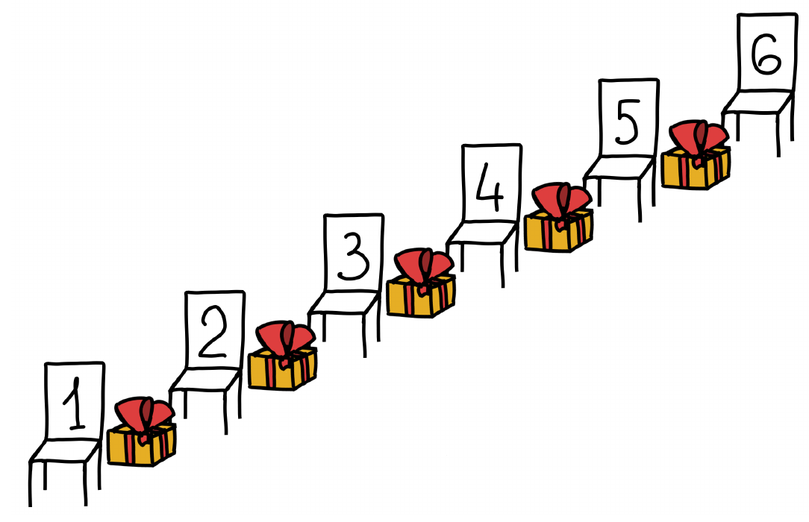

Друг за другом стоят шесть стульев, между каждыми двумя соседними стульями на полу лежит по одному подарку (см. рисунок). На четырёх стульях сидят Аня, Оля, Коля и Боря, все смотрят в одном направлении. Они сказали следующее:

Аня: «Впереди меня подарков больше, чем позади.»

Оля: «Позади меня подарков больше, чем впереди.»

Коля: «Между Олей и Борей столько же подарков, сколько между мной и Аней.»

Боря: «Можно убрать один из подарков впереди меня так, что все наши утверждения станут неверны.»

Известно, что все дети сказали правду. Кто на каком стуле сидит?

