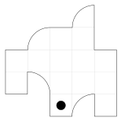

Петя вырезал из бумаги три одинаковые фигурки, положил их друг на друга так, чтобы их края совпали и проткнул все три фигурки насквозь. Потом из этих трёх фигурок (возможно, поворачивая или переворачивая их) он сложил большую фигуру, как на рисунке. Одна из дырок на рисунке отмечена чёрным кружком – выберите ещё две клетки, в которых окажутся дырки.

