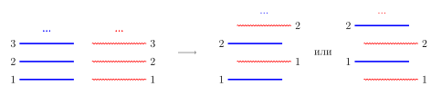

На столе лежит колода из 36 карт, верхняя из которых червонный туз. За одно «перемешивание» фокусник снимает верхнюю половину колоды и кладёт рядом с нижней, а затем делает так, чтобы карты двух стопок чередовались: сначала нижняя карта левой или правой стопки, потом первая снизу другой стопки, потом вторая снизу карта первой стопки, вторая снизу карта другой стопки, и так далее (см. рисунок). Какое наименьшее число перемешиваний нужно сделать фокуснику, чтобы червонный туз оказался нижней картой колоды? При каждом перемешивании то, из какой половины карта окажется снизу, фокусник выбирает сам.

