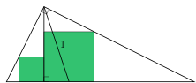

Из прямого угла прямоугольного треугольника опущена высота, и в образовавшиеся треугольники вписаны два квадрата (как на рисунке). Чему может быть равна сумма площадей этих квадратов, если длина биссектрисы прямого угла треугольника равна 1? Введите наименьшее и наибольшее возможные значения; при необходимости округлите до двух знаков после запятой.

