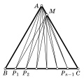

Точки $P_1$, $P_2$, ..., $P_{n-1}$ делят сторону $BC$ равностороннего треугольника $ABC$ на $n$ равных частей: $BP_1=P_1P_2=\ldots=P_{n-1}C$. Точка $M$ выбрана на стороне $AC$ так, что $AM=BP_1$. Докажите, что $\angle AP_1M+\angle AP_2M+\ldots+\angle AP_{n-1}M=30^\circ$, если а) $n=3$; б) $n$ — произвольное натуральное число (рис. 2).

