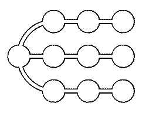

Система укреплений состоит из блиндажей. Некоторые из блиндажей соединены траншеями, причём из любого блиндажа можно перебежать в какой-нибудь другой. В одном из блиндажей спрятался пехотинец. Пушка может одним выстрелом накрыть любой блиндаж. В каждом промежутке между выстрелами пехотинец обязательно перебегает по одной из траншей в соседний блиндаж (даже если по соседнему блиндажу только что стреляла пушка, пехотинец может туда перебежать). Назовём систему надёжной, если у пушки нет гарантированной стратегии поражения пехотинца (т. е. такой последовательности выстрелов, благодаря которой пушка поразит пехотинца независимо от его начального местонахождения и последующих передвижений).

а) Докажите, что система укреплений, изображённая на рисунке, надёжна.
б) Найдите все надёжные системы укреплений, которые перестают быть надёжными после разрушения любой из траншей.

