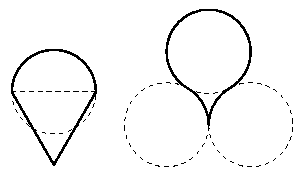

Хулиганы Джей и Боб на уроке черчения нарисовали головастиков (четыре окружности на рисунке — одного радиуса, треугольник — равносторонний, горизонтальная сторона этого треугольника — диаметр окружности). Какой из головастиков имеет бо'льшую площадь?

