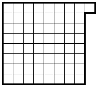

На шахматную доску произвольным образом уложили 32 доминошки (прямоугольника $1 \times 2$), так что доминошки не перекрываются. Затем к доске добавили одну клетку, как показано на рисунке. Разрешается вынимать любую доминошку, а затем класть её на две соседние пустые клетки.

Докажите, что можно расположить все доминошки горизонтально.

