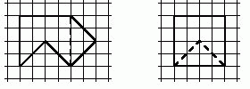

Серёжа придумал фигуру, которую легко разрезать на две части и сложить из них квадрат (см. рис.).

Покажите как по-другому разрезать эту фигуру на две части, из которых тоже можно сложить квадрат.

