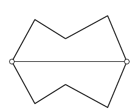

Две точки на плоскости несложно соединить тремя ломаными так, чтобы получилось два равных многоугольника (например, как на рисунке). Соедините две точки четырьмя ломаными так, чтобы все три получившихся многоугольника были равны. (Ломаные несамопересекающиеся и не имеют общих точек, кроме концов.)

