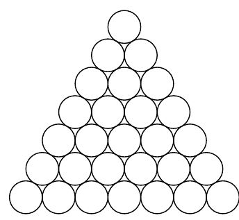

На столе в виде треугольника выложены 28 монет одинакового размера (см. рис.). Известно, что суммарная масса любой тройки монет, которые попарно касаются друг друга, равна 10 г. Найдите суммарную массу всех 18 монет на границе треугольника.

