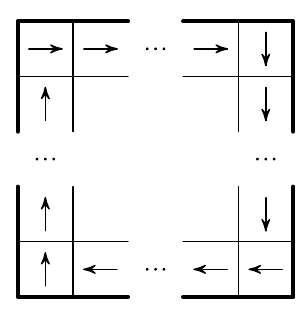

В некоторых клетках квадрата $20 \times 20$ стоит стрелочка в одном из четырёх направлений. На границе квадрата все стрелочки смотрят вдоль границы по часовой стрелке (см. рис.). Кроме того, стрелочки в соседних (возможно, по диагонали) клетках не смотрят в противоположных направлениях. Докажите, что найдётся клетка, в которой стрелочки нет.

