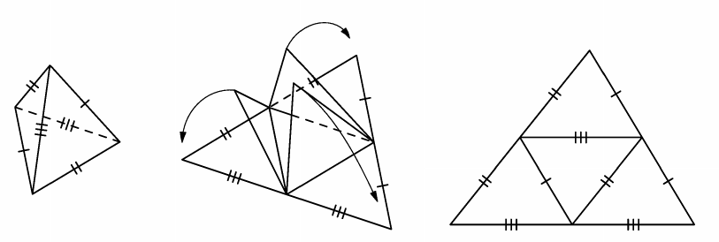

Известно, что всякую треугольную пирамиду, противоположные рёбра которой попарно равны, можно так разрезать вдоль трёх её рёбер и развернуть, чтобы её развёрткой стал треугольник без внутренних разрезов (см. рисунок). Найдётся ли ещё какой-нибудь выпуклый многогранник, который можно разрезать вдоль нескольких его рёбер и развернуть, чтобы его развёрткой стал треугольник без внутренних разрезов?

