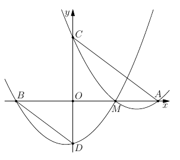

Даны два квадратных трёхчлена со старшим коэффициентом 1. График одного из них пересекает ось $Ox$ в точках $A$ и $M$, а ось $Oy$ — в точке $C$. График другого пересекает ось $Ox$ в точках $B$ и $M$, а ось $Oy$ — в точке $D$. (Здесь $O$ — начало координат; точки расположены как на рисунке). Докажите, что треугольники $AOC$ и $BOD$ подобны.

