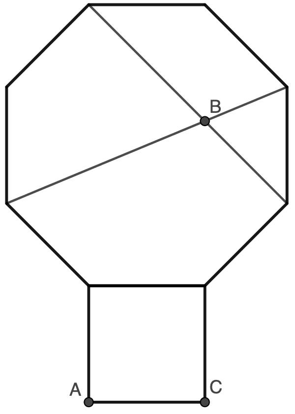

На стороне правильного восьмиугольника во внешнюю сторону построен квадрат. В восьмиугольнике проведены две диагонали, пересекающиеся в точке $B$ (см. рисунок). Найдите величину угла $ABC$. (Многоугольник называется правильным, если все его стороны равны и все его углы равны.)

