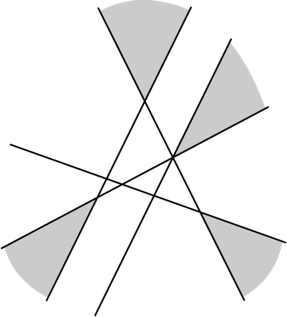

Плоскость разбита на части несколькими прямыми, среди которых есть непараллельные. Те части, граница которых состоит из двух лучей, закрасили. После этого проведена ещё одна прямая. Докажите, что, независимо от положения новой прямой, по обе стороны от неё найдутся закрашенные точки.

Пример расположения прямых (без последней прямой) изображен на рисунке.

