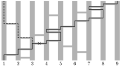

В ряд стоят 9 вертикальных столбиков. В некоторых местах между соседними столбиками вставлены горизонтальные палочки, никакие две не находятся на одной высоте. Жук ползёт снизу вверх; встречая палочку, он переползает по ней на соседний столбик и продолжает ползти вверх. Известно, что если жук начинает внизу первого (самого левого) столбика, он закончит свой путь на девятом (самом правом) столбике.

Всегда ли можно убрать одну палочку так, чтобы жук в конце пути оказался наверху пятого столбика? (Например, если палочки расположены как на рисунке, жук будет ползти по сплошной линии. Если убрать третью палочку на пути жука, дальше он поползёт по пунктирной линии.)

