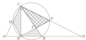

В треугольнике $ABC$ с прямым углом $C$ провели высоту $CH$. Некоторая окружность, проходящая через точки $C$ и $H$, повторно пересекает отрезки $AC$, $CB$ и $BH$ в точках $Q$, $P$ и $R$ соответственно. Отрезки $HP$ и $CR$ пересекаются в точке $T$. Что больше: площадь треугольника $CPT$ или сумма площадей треугольников $CQH$ и $HTR$?

