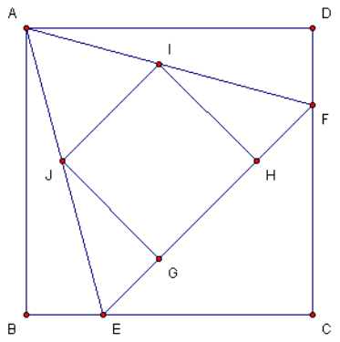

Let $ABCD$ be a unit square. The point $E$ lies on $BC$ and $F$ lies on $AD$. $\triangle AEF$ is equilateral. $GHIJ$ is a square inscribed in $\triangle AEF$ so that $GH$ is on $EF$. Compute the area of $GHIJ$.

