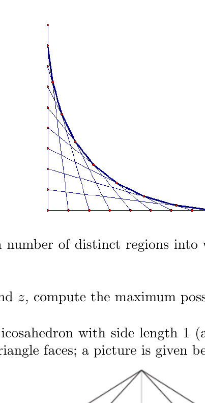

Let $A=(0,0)$, $B=(1,0)$, and $C=(0,1)$. Divide $AB$ into $n$ equal segments, and call the endpoints of these segments $A=B_0,B_1,B_2,\cdots,B_n=B$. Similarly, divide $AC$ into $n$ equal segments with endpoints $A=C_0,C_1,C_2,\cdots,C_n=C$. By connecting $B_i$ and $C_{n-i}$ for all $0\le i\le n$, one gets a piecewise curve consisting of the uppermost line segments. Find the equation of the limit of this piecewise curve as $n$ goes to infinity.

