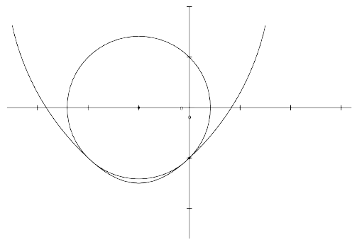

Consider the parabola $y=ax^2+2019x+2019$. There exists exactly one circle which is centered on the $x$-axis and is tangent to the parabola at exactly two points. It turns out that one of these tangent points is $(0,2019)$. Find $a$. (Diagram below does not picture the specified parabola.)

