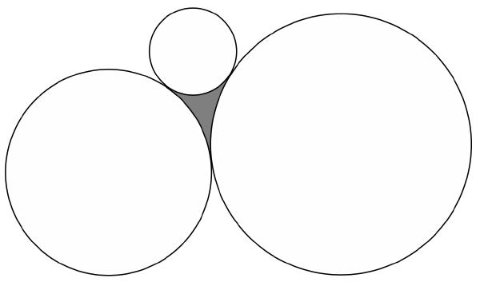

Three circles with radii 23, 46, and 69 are tangent to each other as shown in the figure below (figure is not drawn to scale).

Find the radius of the largest circle that can fit inside the shaded region.
