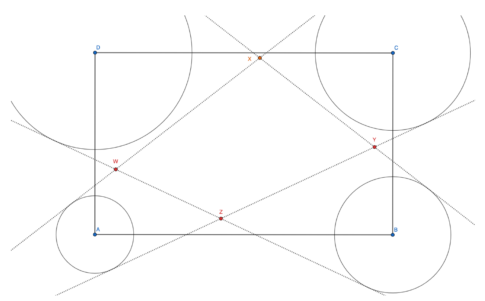

Rectangle $ABCD$ has an area of $30$. Four circles of radius $r_1=2,r_2=3,r_3=5,$ and $r_4=4$ are centered on the four vertices $A,B,C,$ and $D$ respectively. Two pairs of external tangents are drawn for the circles at $A$ and $C$ and for the circles at $B$ and $D$. These four tangents intersect to form a quadrilateral $WXYZ$ where $\overline{WX}$ and $\overline{YZ}$ lie on the tangents through the circles on $A$ and $C$. If $\overline{WX}+\overline{YZ}=20$, find the area of quadrilateral $WXYZ$.

