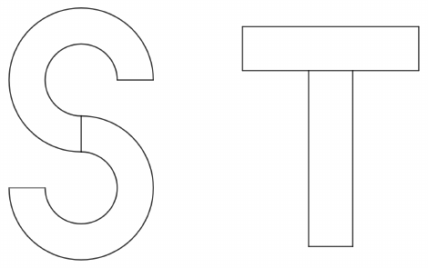

Arpit begins with a circular paper disk of radius $8$ and cuts out a circular disk of radius $4$ with the same center, which results in an annulus. Then, he cuts out and removes a sector of the annulus with a central angle of $90^\circ$. He repeats these steps beginning with another circular disk of radius $8$ and glues together the two annulus sectors in the shape of an S as shown on the left below. After making the S, Arpit also makes a letter T by gluing together two rectangles each having dimensions $x\times 4x$ as shown on the right below. Compute the value of $x$ Arpit should choose so that the S and T have the same area.

