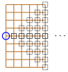

A teacher stands at $(0,10)$ and has some students, where there is exactly one student at each integer position in the following triangle:

Here, the circle denotes the teacher at $(0,10)$ and the triangle extends until and includes the column $(21,y)$.

A teacher can see a student $(i,j)$ if there is no student in the direct line of sight between the teacher and the position $(i,j)$. Compute the number of students the teacher can see (assume that each student has no width—that is, each student is a point).
