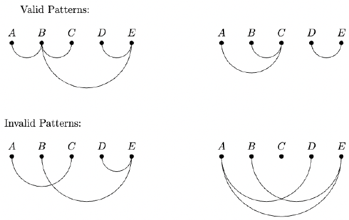

Jana is decorating her room by hanging zero or more strings of lights. She has $5$ collinear attachment points (A, B, C, D, and E), and she can connect any two attachment points with a semicircular string of lights (direction hanging downward), as long as no two strings cross. In how many different patterns can she hang the lights?

