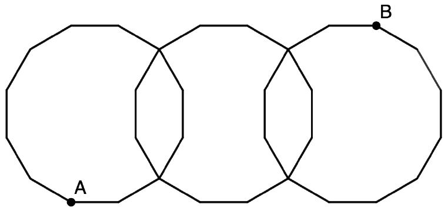

Perry bakes a pineapple upside-down cake with $3$ slices of pineapple on top, each in the shape of regular dodecagons of side length $1$. The pineapple slices overlap each other as shown in the figure. Compute the length of the cut $AB$ that Perry makes to slice the cake in half.

