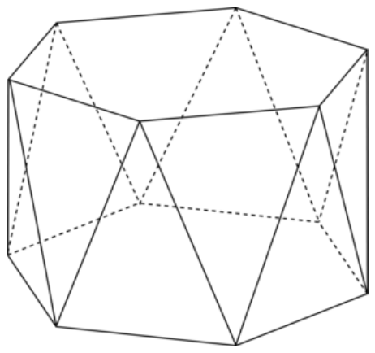

Consider a prism with regular hexagon bases. We form an antiprism by removing the lateral faces, rotating one of the bases $30^\circ$ about the axis passing through the centers of the bases, and forming $12$ triangular faces between the bases where each triangular face consists of one vertex of one of the bases and the two closest vertices of the other base. Compute the ratio of the volume of the antiprism to the volume of the original prism.

