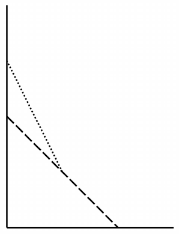

Consider the pair of ladders shown in the below image. The bottom ladder (dashed line) connects the points $(0,4)$ and $(4,0)$. The top ladder (dotted line) is attached to the bottom ladder at $(2,2)$ and touches the wall at $(0,6)$. This pair of ladders begins to slide down the wall, such that the top ladder remains attached to the midpoint of the bottom ladder. When the bottom ladder touches the wall at the point $(0,2)$, the end at which it touches the wall is moving downward at the rate of $2$ units per second. At that point in time, what is the rate at which the wall end of the top ladder is moving downward, in units per second?

