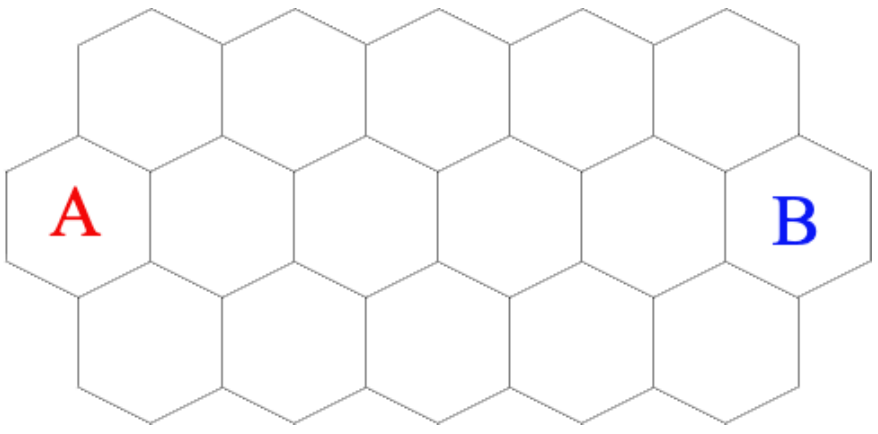

How many ways are there to color each hexagon below either red (denoted by $A$) or blue (denoted by $B$) such that the region of all red hexagons is contiguous, the region of all blue hexagons is contiguous, and each hexagon borders at least two hexagons of the same color? The leftmost and rightmost hexagons are already colored.

