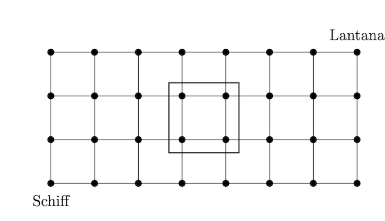

Consider the $4$ by $8$ grid of points below that represent the Stanford campus. Stanford has developed a way to teleport Main Quad (represented by the rectangle on the lattice) anywhere on campus such that $4$ points are contained within the rectangle and none of these points are dorms (the dimensions of Main Quad remain the same as in the figure). The bottom-left and top-right corners of the grid are dorms.

Abby wants to bike from Schiff to Lantana, but does not want to pass through any points in Main Quad. If Abby only moves from one lattice point to another in the up and right directions (and Main Quad does not move as she bikes), compute the sum of the number of paths she can take for all possible positions of Main Quad.

