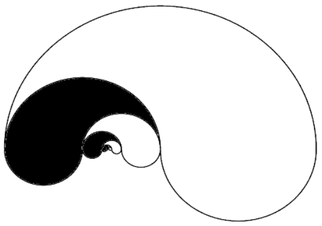

The image to the right is comprised of black and white interlocking shapes that are similar to each other. Each shape’s perimeter is composed of one "outer" semicircular arc and two smaller "inner" semicircular arcs. The largest shape, which is white, has an outer radius of length $1$ and an inner radius of length $1/2$. If the pattern depicted continues infinitely, what is the positive difference between the total area of the white shapes and the total area of the black shapes?

