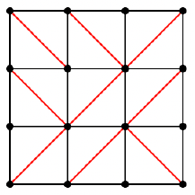

In a $3 \times 3$ grid, exactly one of the two possible diagonals is drawn in each of the nine cells. Compute the number of ways to choose the diagonals such that there is a continuous path along diagonals from the bottom-left vertex to the top-right vertex. One such grid is shown.

