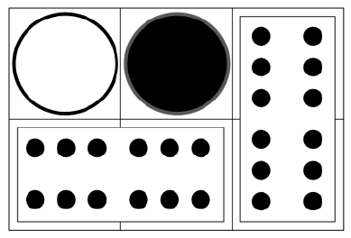

Kevin has two indistinguishable $2\times1$ dominoes (labeled $6-6$), and Ryan has two $1\times1$ distinguishable checkers (one black and one white). They take turns placing one piece at a time on a fixed $2\times3$ grid, aligning with the gridlines without overlap. Each piece must be placed face up, preserving its markings. Compute the number of possible final configurations. One example is shown (rotated or reflected boards are considered distinct).

