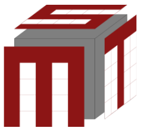

We have a $5\times5\times5$ cube made up of $1\times1\times1$ cardinal red and transparent pieces. When looking at the cube, we always see a cardinal red piece if it is behind any transparent pieces. When viewing each face straight-on, we can see the letters S, M, T on the top, front, and right side, respectively (as arranged in the diagram). Compute the maximum possible number of cardinal red pieces within this cube.

Note: cardinal red pieces are rendered black on your printed copy.
