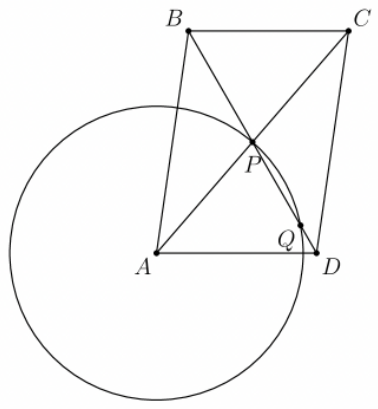

Let $ABCD$ be a parallelogram with $AB>BC$ and diagonals intersecting at point $P$. Circle $\omega$ has its center at point $A$, radius $AP$, and intersects $BD$ again at point $Q$ on line segment $PD$. If $PQ=3$, $QD=1$, and $ABCD$ has integer side lengths, compute the length of $AC$.

