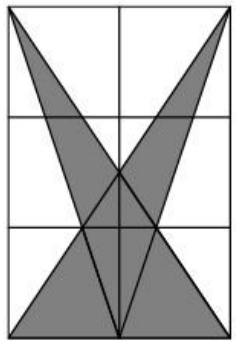

A $3\times 2$ rectangle is divided into grid lines spaced one unit apart. The vertices on the grid are connected to form two overlapping triangles, both of which are shaded. Compute the area of the shaded region.

